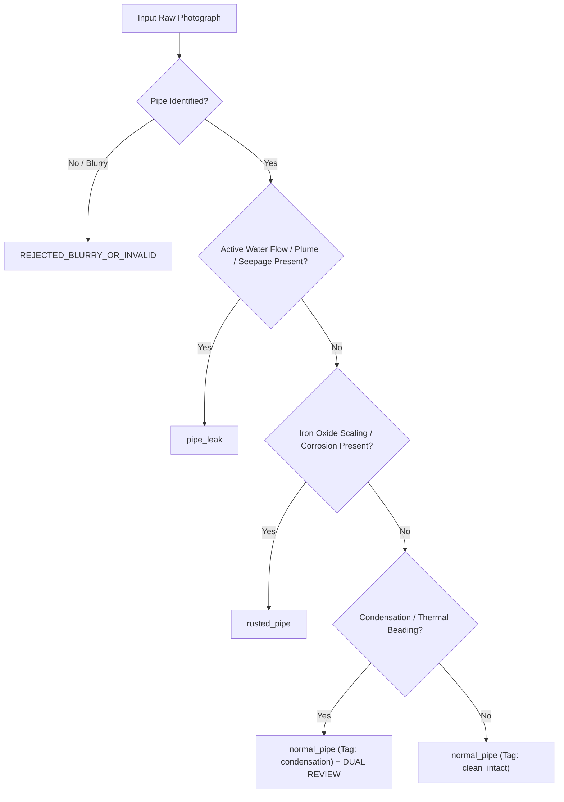

# NAGARSETU WATER AI ANNOTATION GUIDELINES (PHASE 12)

## 1. Scope & Objective

This standard operating procedure (SOP) governs the annotation, verification, and quality assurance of visual inspection imagery for the NagarSetu Water Supply AI system.

The primary objective is to establish deterministic, unambiguous visual boundaries between **active pipe breaches**, **benign uncorroded pipelines**, **dry structural corrosion**, and **ambient environmental moisture**.

---

## 2. Primary Classification Taxonomy

Every acquired photograph must be assigned exactly one **Primary Class**:

---

## 3. Class Definitions & Positive / Negative Criteria

### 3.1 Class 1: `normal_pipe`

- **Core Definition:** Intact, non-leaking pipeline infrastructure serving domestic or municipal distribution.
- **Positive Visual Criteria:**
  - Dry, intact tubular profile with continuous cylindrical contours.
  - Intact protective coating: smooth white/blue PVC, uniform silver zinc galvanization, or sound black bituminous coat on ductile iron.
  - Dry joint couplings, intact rubber gaskets, tightened flange bolts.
  - Verified Examples in Dataset: `4412.webp`, `images (1).jpg`, `images (4).jpg`, `Screenshot 2026-10-09 011835.png`.
- **Negative Boundary (What is NOT normal_pipe):**
  - Continuous water jet or active droplet formation (classify as `pipe_leak`).
  - Severe flaky rust scaling exceeding 25% of pipe surface area (classify as `rusted_pipe`).

---

### 3.2 Class 2: `pipe_leak`

- **Core Definition:** Active failure of pipeline containment resulting in fluid emission into the surrounding environment.
- **Positive Visual Criteria:**
  - High-velocity pressurized water plume or conical spray trajectory.
  - Visible water bubbling or pooling directly at a joint, crack, or puncture.
  - Wetting plume radiating outward from a distinct mechanical rupture.
  - Gravity drip forming consecutive drops from a joint seam.
  - Verified Examples in Dataset: `burst-water-pipe.jpg`, `images (2).jpg`, `images (13).jpg`, `waste-water-pipe-leaking-pvc-260nw-1653987562.png`.
- **Negative Boundary (What is NOT pipe_leak):**
  - Static surface dampness from morning atmospheric dew with no source puncture.
  - Dry reddish-brown rust stains left behind by a previous, now-repaired leak.
  - Street runoff or puddle adjacent to a dry, unbreached pipe.

---

### 3.3 Class 3: `rusted_pipe`

- **Core Definition:** Structural iron oxidation and material degradation without active pressurized fluid emission.
- **Positive Visual Criteria:**
  - Visible granular, orange/red/brown iron oxide scaling or flaking blisters.
  - Surface pitting, metal thinning, or oxidized coupling flanges.
  - Pipe surface is palpably dry with no active water flow or droplets.
  - Verified Examples in Dataset: `Screenshot 2026-10-09 011821.png`, `Screenshot 2026-10-09 011833.png`.
- **Negative Boundary (What is NOT rusted_pipe):**
  - Corroded pipe with active pressurized water spraying through an oxidation hole: **MUST be classified as `pipe_leak`** with secondary tag `corrosion`.
  - Discoloration from dirt, mud splashes, or algae on PVC (classify as `normal_pipe`).

---

## 4. Secondary Scenario Tags & Disambiguation Rules

| Secondary Tag | Visual Phenomenon | Key Discriminator | Review Protocol |
| :--- | :--- | :--- | :--- |
| `high_pressure_spray` | Continuous water jet or mist fan | High velocity, directional plume, aerated white froth | Single review sufficient |
| `joint_flange_leak` | Water seeping at coupler or bolt seams | Moisture emanates from connector gap | Single review sufficient |
| `hairline_crack` | Microscopic fracture with weeping moisture | Continuous damp seam along pipe body | **Dual Review Mandatory** |
| `corrosion_dry` | Dry rust scaling, no liquid | Absence of specular moisture reflections | Single review sufficient |
| `cold_pipe_condensation` | Uniform micro-droplets on cold pipe | Distributed evenly over pipe perimeter, no fissure | **Dual Review Mandatory** |
| `wet_surface_non_leak` | Damp ground near intact dry pipe | Puddle boundary does not touch pipe rupture | **Dual Review Mandatory** |
| `specular_glare` | Harsh sunlight reflection on smooth pipe | Over-exposed white highlight, dry surrounding area | Single review sufficient |

---

## 5. Dual-Reviewer Verification Workflow

To guarantee zero mislabeling on subtle or controversial images, the following workflow is machine-enforced:

1. **Trigger Condition for Dual Review:**
   - Any image tagged with `condensation`, `hairline_crack`, or `wet_surface_non_leak`.
   - Any image where the Primary Reviewer confidence is $< 90\%$.
   - Any rusted pipe with questionable surface dampness.
2. **Reviewer Qualifications:**
   - Reviewer 1: Trained AI Dataset Annotator.
   - Reviewer 2: Senior Civil / Mechanical Verification Engineer.
3. **Dispute Resolution:**
   - If Reviewer 1 and Reviewer 2 disagree on whether an image is a leak vs condensation/rust, the image is marked `uncertain_needs_review` and **quarantined from training and test sets**.
   - Under no circumstances may an ambiguous image be forced into a definitive class.

---

## 6. Image Quality & Privacy Gate

Before ingest, every original photograph must pass these automated quality gates:
1. **Resolution Gate:** Minimum $640 \\times 640$ pixels.
2. **Sharpness Gate:** Laplacian variance $\\ge 100.0$ (reject blurred shots).
3. **Privacy Gate:** Strictly zero identifiable human faces, vehicle license plates, or readable private residential door numbers. If present, image must be blurred or rejected prior to cataloging.
4. **Authenticity Gate:** Cryptographic SHA-256 hash verified. Zero synthetic generation permitted.

