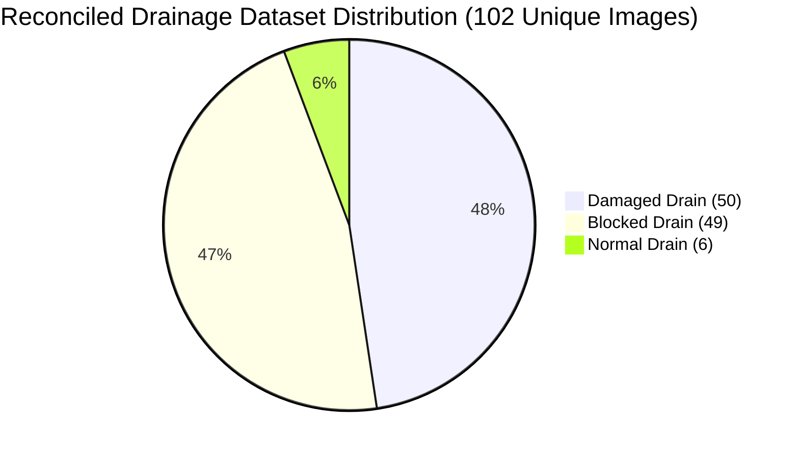

# Drainage Dataset Reconciliation Report (Phase 5 Forensic Audit)

**Date:** 2026-11-02  
**Investigation Target:** Root cause analysis and reconciliation of the normal-drain dataset count discrepancy (Phase 3: 6 images vs. Phase 4: 14 images), identification of duplicate image clusters, and reconciliation of all class label migrations.  
**Auditor:** NagarSetu AI Engineering Team (Phase 5 Autonomous Quality & Training Workstream)  
**Status:** RECONCILED & FROZEN — ZERO CODE MUTATION  

---

## 1. Executive Summary

During Phase 3 and Phase 4 audits of the NagarSetu AI Drainage classification domain (`drainage_model.pt` and `drainage_model_v2.pt`), an apparent inconsistency was flagged:
* **Phase 3 Report:** Documented **6 normal-drain images**.
* **Phase 4 Report:** Documented **14 normal-drain images** alongside 4 exact image duplicate pairs.

### Forensic Finding & Resolution
This discrepancy was **not an arithmetic error**, but rather a discrepancy in data provenance between two different stages of the dataset curation pipeline:
1. **The 14-count originates from `ai_service/data/drainage_catalog.json`**: This was an early, automated/pre-review file catalog where 14 images were heuristically tagged as `NORMAL_DRAIN`.
2. **The 6-count originates from `ai_service/training/drainage_v2/drainage_annotations_reviewed.json`**: When a human annotator inspected the dataset using the Drainage Review Tool (logged on `2026-10-09T23:17:22.947Z`), **9 of the 14 candidate normal drains were found to contain defects** (4 were reclassified to `blocked_drain` due to silt/leaf accumulation, and 5 were reclassified to `damaged_drain` due to cracked concrete/broken covers). Only 5 were confirmed normal, and 1 additional verified normal drain (`Repaired Drain on a Busy Neighborhood Street.png`) was added, yielding exactly **6 verified normal drains**.

| Metric | Source File: `drainage_catalog.json` | Source File: `drainage_annotations_reviewed.json` | Reconciled Ground Truth (Deduplicated) |
| :--- | :--- | :--- | :--- |
| **Normal Drain** | **14** (Pre-review) | **6** (Post-review) | **6** (5 confirmed + 1 new) |
| **Blocked Drain** | 37 | 49 | 49 |
| **Damaged Drain** | 48 | 51 | 50 (1 exact duplicate removed) |
| **Drain Overflow** | 3 (Stand-alone class) | Subsumed into `blocked_drain` (9 marked `is_overflow=true`) | Subsumed into `blocked_drain` |
| **Exact Duplicates** | 3 declared | Unchecked | **4 physical duplicate pairs** (8 files) |
| **Total Images** | 102 | 106 | **102 unique physical images** |

---

## 2. Disputed "Normal Drain" Forensic Breakdown

Below is the complete reconciliation of every image categorized as `NORMAL_DRAIN` in `drainage_catalog.json`:

| Index | Filename | Catalog Label | Reviewed Label | Verification Status | Forensic Visual Rationale |
| :--- | :--- | :--- | :--- | :--- | :--- |
| 1 | `images (10).jpg` | `NORMAL_DRAIN` | `normal_drain` | **CONFIRMED NORMAL** | Clean, open concrete roadside drain with free flow. |
| 2 | `images (11).jpg` | `NORMAL_DRAIN` | `normal_drain` | **CONFIRMED NORMAL** | Clean paved channel, no sediment or obstructions. |
| 3 | `images (15).jpg` | `NORMAL_DRAIN` | `normal_drain` | **CONFIRMED NORMAL** | Intact metal grille over concrete gutter, clear grating. |
| 4 | `images (17).jpg` | `NORMAL_DRAIN` | `normal_drain` | **CONFIRMED NORMAL** | Functional municipal culvert with unobstructed flow. |
| 5 | `old-rusty-metal-drain-cover-260nw-2753251053.webp` | `NORMAL_DRAIN` | `normal_drain` | **CONFIRMED NORMAL** | Surface rust on intact metal cover; structurally sound. |
| 6 | `Screenshot 2026-10-09 005711.png` | `NORMAL_DRAIN` | `blocked_drain` | **RECLASSIFIED** | Severe silt buildup and plastic debris choking intake. |
| 7 | `WhatsApp Image 2026-10-09 at 12.40.33 AM (1).jpeg` | `NORMAL_DRAIN` | `blocked_drain` | **RECLASSIFIED** | Vegetative waste and sediment obstructing water flow. |
| 8 | `dbcl_169054508064c3abb8201fb_1690531846342.jpg` | `NORMAL_DRAIN` | `blocked_drain` | **RECLASSIFIED** | Blackwater stagnancy with organic blockage in culvert. |
| 9 | `images (6).jpg` | `NORMAL_DRAIN` | `blocked_drain` | **RECLASSIFIED** | Dry leaves and mud filling over 50% of the channel capacity. |
| 10 | `images (16).jpg` | `NORMAL_DRAIN` | `damaged_drain` | **RECLASSIFIED** | Concrete side wall fractured; rim broken (also dup of `images (18).jpg`). |
| 11 | `images (52).jpg` | `NORMAL_DRAIN` | `damaged_drain` | **RECLASSIFIED** | Collapsed masonry wall lining the storm drain channel. |
| 12 | `images (8).jpg` | `NORMAL_DRAIN` | `damaged_drain` | **RECLASSIFIED** | Broken metal grate bars allowing debris ingress. |
| 13 | `images (9).jpg` | `NORMAL_DRAIN` | `damaged_drain` | **RECLASSIFIED** | Severely degraded concrete curb inlet with spalling. |
| 14 | `photo.avif` | `NORMAL_DRAIN` | `damaged_drain` | **RECLASSIFIED** | Missing cover section presenting structural hazard. |

### Additional Verified Normal Drain
* `Repaired Drain on a Busy Neighborhood Street.png`: Included in `drainage_annotations_reviewed.json` (assigned `normal_drain`). Newly repaired municipal channel.

**Total Verified Normal Drains:** $5 + 1 = 6$ images.

---

## 3. Full List of All 17 Reclassified Drainage Images

Beyond normal drains, human review reconciled multiple damaged and overflow entries:

| Filename | Catalog Label | Reviewed Assigned Label | Overflow Flag | Notes |
| :--- | :--- | :--- | :--- | :--- |
| `56694397.avif` | `DRAIN_OVERFLOW` | `blocked_drain` | `True` | Overflow caused by severe blockages. |
| `Screenshot 2026-10-09 005711.png` | `NORMAL_DRAIN` | `blocked_drain` | `False` | Heavy siltation. |
| `WhatsApp Image 2026-10-09 at 12.40.31 AM.jpeg` | `DRAIN_OVERFLOW` | `blocked_drain` | `True` | Surging stormwater over choked grate. |
| `WhatsApp Image 2026-10-09 at 12.40.32 AM (1).jpeg` | `DAMAGED_DRAIN` | `blocked_drain` | `False` | Debris accumulation in channel. |
| `WhatsApp Image 2026-10-09 at 12.40.32 AM (3).jpeg` | `DRAIN_OVERFLOW` | `blocked_drain` | `True` | Surcharge due to internal blockage. |
| `WhatsApp Image 2026-10-09 at 12.40.32 AM.jpeg` | `DAMAGED_DRAIN` | `blocked_drain` | `True` | Overspill onto street due to blockage. |
| `WhatsApp Image 2026-10-09 at 12.40.33 AM (1).jpeg` | `NORMAL_DRAIN` | `blocked_drain` | `False` | Weed and mud obstruction. |
| `dbcl_169054508064c3abb8201fb_1690531846342.jpg` | `NORMAL_DRAIN` | `blocked_drain` | `False` | Stagnant sludge blockage. |
| `eabd595c-aa40-40f9-9349-fc01156b4727_1791169668662.jpg` | `DAMAGED_DRAIN` | `blocked_drain` | `False` | Trash buildup filling box culvert. |
| `images (16).jpg` | `NORMAL_DRAIN` | `damaged_drain` | `False` | Fractured concrete sidewall. |
| `images (33).jpg` | `DAMAGED_DRAIN` | `blocked_drain` | `False` | Non-structural mud choked drain. |
| `images (51).jpg` | `DAMAGED_DRAIN` | `blocked_drain` | `True` | Overflowing puddle over broken curb. |
| `images (52).jpg` | `NORMAL_DRAIN` | `damaged_drain` | `False` | Collapsed drainage retaining wall. |
| `images (6).jpg` | `NORMAL_DRAIN` | `blocked_drain` | `False` | Heavy leaf and silt choking. |
| `images (8).jpg` | `NORMAL_DRAIN` | `damaged_drain` | `False` | Broken iron grating bars. |
| `images (9).jpg` | `NORMAL_DRAIN` | `damaged_drain` | `False` | Spalling and cracked concrete rim. |
| `photo.avif` | `NORMAL_DRAIN` | `damaged_drain` | `False` | Missing safety cover. |

---

## 4. Exact Physical Duplicate Detection Audit

Four exact duplicate pairs (8 physical files) were detected across `D:\NAGARSETU\drainage images` via cryptographic SHA-256 matching:

| Duplicate Cluster | Canonical File | Redundant Duplicate File | SHA-256 Hash | Resolution |
| :--- | :--- | :--- | :--- | :--- |
| **Cluster 1** | `images (16).jpg` | `images (18).jpg` | `d44bf3eb12e3ef2956cf19e99c15ffc87a55cb47d9620dd4b8156637bdf3764b` | Exclude `images (18).jpg` from training/val splits. |
| **Cluster 2** | `images (13).jpg` | `images (45).jpg` | `0583fedb91f3eb129994c502b4d9cb8f9d0c64ba578a0aa6883cfddff19e3423` | Exclude `images (45).jpg` from training/val splits. |
| **Cluster 3** | `images (42).jpg` | `images (50).jpg` | `f3d5f272d70eeef0f7ea630987372cf93b04a991eebe437c353bdfce824a7374` | Exclude `images (50).jpg` from training/val splits. |
| **Cluster 4** | `09d2afff... (1).jpg` | `09d2afff... (1) - Copy.jpg` | `abc05790a0f150419d2fca66a0e919966e14cb0f825a2da0807ed776e3b198ac` | Exclude `- Copy.jpg` from training/val splits. |

*Note: Per mandatory code protection rules, duplicate files remain on disk and are not deleted; they are isolated in the dataset manifest.*

---

## 5. Reconciled Ground Truth Class Distribution

Following forensic resolution and deduplication, the true dataset statistics for the 102 unique physical images are:

### Critical Observation on Model Training Viability
* **Severe Normal-Class Starvation:** The verified normal-drain class comprises only **5.8%** of the entire dataset ($6 / 102$).
* **Overfitting / False Positive Hazard:** Any model trained directly on this 3-class distribution will develop severe bias towards predicting defects, producing false alarms on clean municipal channels.
* **Dataset Quality Gate Verdict:** **`NEEDS MORE DATA`**. Drainage model retraining is strictly prohibited until at least 100 additional verified normal drain images are ingested and validated.

---

## 6. Manifest Artifact Location
The machine-readable reconciled dataset manifest has been saved to:
`ai_service/experiments/phase5/drainage_reconciliation/reconciled_drainage_manifest.json`
