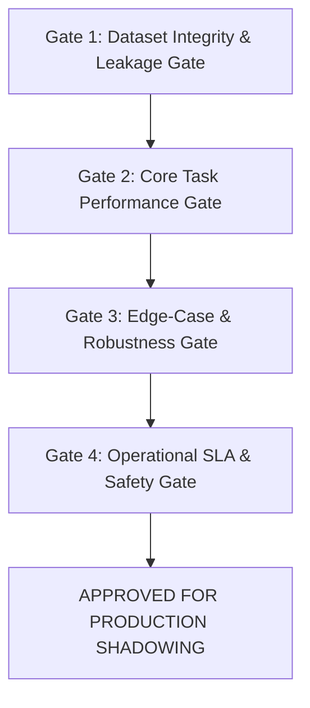

# Phase 7: NagarSetu AI Model Acceptance Criteria Framework

**Date:** 2026-11-03  
**Framework Purpose:** Formal, risk-calibrated, domain-specific quantitative gates required before ANY candidate AI model or inference adapter can be approved to supersede a production baseline.  
**Governing Principle:** Zero arbitrary universal thresholds; criteria are calibrated to operational civic risk, baseline benchmarks, and citizen complaint reliability.  
**Deliverable Locations:**
- [phase7_model_acceptance_criteria.md](file:///d:/NAGARSETU/NAGARSETU%203.1/phase7_model_acceptance_criteria.md)
- [phase7_model_acceptance_criteria.md](file:///d:/NAGARSETU/NAGARSETU%203.1/ai_service/experiments/phase7/reports/phase7_model_acceptance_criteria.md)

---

## 1. Multi-Tier Acceptance Gate Structure

To earn promotion from `EXPERIMENTAL` to `PRODUCTION_CANDIDATE`, a model must clear four sequential gates:

1. **Gate 1: Dataset Integrity & Leakage Gate:** Zero cryptographic duplicates across splits; zero camera sequence leakage; balanced representation; verified source licensing.
2. **Gate 2: Core Task Performance Gate:** Statistically superior or equivalent Macro F1 / mAP on frozen independent test set.
3. **Gate 3: Edge-Case & Robustness Gate:** Low False-Positive Rate (FPR) on negative controls (normal road, clean gutters, intact pipes); high recall on difficult conditions (shadows, thin sprays, hairline cracks).
4. **Gate 4: Operational SLA & Safety Gate:** Warm inference latency within civic budget (< 500 ms CPU); peak RAM < 200 MB; graceful handling of corrupt/empty inputs; bit-identical rollback guarantee.

---

## 2. Domain-Specific Quantitative Acceptance Thresholds

### Domain 1: Road Damage Detection (Object Detection)
* **Production Baseline:** `civicmodel.pt` (Single-Class Pothole Detector)
* **Target Multi-Class Transition:** RDD2022 (D00: Longitudinal, D10: Transverse, D20: Alligator, D40: Pothole)
* **Operational Risk Profile:** Moderate safety risk from potholes; low risk from surface micro-cracks. False alarms create unnecessary municipal road inspection dispatches.

| Evaluation Criterion | Metric | Production Baseline | Minimum Candidate Acceptance Threshold | Rationale & Risk Calibration |
| :--- | :--- | :--- | :--- | :--- |
| **Dataset Completeness** | Training / Test Samples | Pothole dataset | $\ge 1,000$ verified Indian road frames | Multi-class requires representative crack distributions |
| **Split Isolation** | Sequence Leakage | Verified | **0.0% frame leakage** across dashcam video passes | Prevents spatial background memorization |
| **Overall Detection** | **mAP50** | Baseline single | **$\ge 0.6500$** | High localization accuracy across asphalt conditions |
| **Overall Detection** | **mAP50-95** | Baseline single | **$\ge 0.3800$** | Tight bounding boxes for repair volume estimation |
| **Critical Hazard (D40)** | **Per-Class AP50 (Potholes)** | Single-class AP | **$\ge 0.7500$** | Potholes represent direct vehicular hazard |
| **Surface Cracks (D00/D10/D20)**| **Per-Class AP50 (Cracks)** | N/A | **$\ge 0.5500$** | Cracking requires moderate precision to prioritize resurfacing |
| **Clean Road Specificity** | **False Positive Rate (FPR)** | $< 5.0\%$ | **$\le 4.0\%$** on clean roads / tar patches | Avoids false repair dispatches on sealed asphalt |
| **Latency SLA** | **P95 Latency (CPU)** | 380 ms | **$\le 450$ ms** | Asynchronous intake SLA allows up to 2,000 ms |
| **Memory SLA** | **Peak Inference RAM** | 3.56 MB | **$\le 50$ MB** | Runs efficiently in containerized CPU environments |

---

### Domain 2: Solid Waste Classification (Multi-Class Object Detection)
* **Production Baseline:** `best.pt` (6-Class General Waste Detector)
* **Target Schema:** `BIODEGRADABLE`, `CARDBOARD`, `GLASS`, `METAL`, `PAPER`, `PLASTIC`
* **Operational Risk Profile:** Moderate operational risk. Misclassifying recyclable items (cardboard/plastic) sends material to wrong sorting streams. Extreme plastic dominance must be eliminated.

| Evaluation Criterion | Metric | Production Baseline | Minimum Candidate Acceptance Threshold | Rationale & Risk Calibration |
| :--- | :--- | :--- | :--- | :--- |
| **Dataset Balance** | Min Bounding Boxes per Class | 1 box for cardboard | **$\ge 150$ boxes per class** in train, $\ge 30$ in val/test | Eliminates the 5-class validation starvation void |
| **Split Independence** | Zero-Instance Classes | 5 classes zero in val | **0 zero-instance classes** across train/val/test | Essential for mathematical validation computability |
| **Overall Detection** | **mAP50** | 0.71 (plastic-skewed) | **$\ge 0.6800$** across all 6 classes | Must be balanced, not dominated by plastic |
| **Per-Class Detection** | **Min AP50 for Any Class** | 0.00 (cardboard) | **$\ge 0.5000$** for every individual class | Prevents zero-shot blind spots in sorting |
| **Plastic Domination** | Class Proportion | 63.6% plastic | **$\le 35.0\%$** of total annotated boxes | Enforces genuine dataset diversity |
| **Latency SLA** | **P95 Latency (CPU)** | 466 ms | **$\le 500$ ms** | Fits municipal field-app submission budget |
| **Memory SLA** | **Peak Inference RAM** | 3.54 MB | **$\le 60$ MB** | Container-safe footprint |

---

### Domain 3: Drainage Condition Classification (3-Class Categorization)
* **Production Baseline:** `drainage_model.pt`
* **Target Schema:** `normal_drain`, `blocked_drain`, `damaged_drain`
* **Operational Risk Profile:** High environmental and flood hazard during monsoon. Severe penalty for false positives on clean gutters (unnecessary municipal unclogging crews dispatched).

| Evaluation Criterion | Metric | Production Baseline | Minimum Candidate Acceptance Threshold | Rationale & Risk Calibration |
| :--- | :--- | :--- | :--- | :--- |
| **Dataset Census** | Normal Drain Control Samples | 6 verified images (5.8%)| **$\ge 100$ verified normal drains** ($\ge 30\%$ of dataset) | Resolves the severe normal-class starvation |
| **Overall Classification**| **Macro F1 Score** | 0.8556 (high variance) | **$\ge 0.8800$** | High harmonic balance across all 3 states |
| **Clean Gutter Precision**| **Normal Drain Precision** | 0.6667 | **$\ge 0.9000$** | **CRITICAL:** Prevents false alarms on unblocked drains |
| **Normal Drain Recall** | **Normal Drain Sensitivity** | 1.0000 (2/2 test) | **$\ge 0.9200$** on $\ge 25$ held-out normal controls | Confirms generalizability beyond tiny sample |
| **Blockage Sensitivity** | **Blocked Drain Recall** | 0.8571 | **$\ge 0.9200$** | Catches real flooding hazards |
| **Structural Integrity** | **Damaged Drain Recall** | 0.8571 | **$\ge 0.9000$** | Catches broken covers and wall fractures |
| **Latency SLA** | **P95 Latency (CPU)** | 141 ms | **$\le 120$ ms** | Real-time classification on mobile/web |
| **Inference Stability** | **Coefficient of Variation (CV)** | Stabilized | **$\le 25.0\%$** across repeated runs | Ensures predictable container performance |

---

### Domain 4: Water Pipeline Damage Detection (Condition Classification & Patch Inference)
* **Production Baseline:** `water_pipe_model.pt` (MobileNetV3-Small)
* **Candidate Framework:** MobileNetV3-Small Candidate + Calibrated Hierarchical Patch Inference
* **Operational Risk Profile:** Critical public utility risk. Unreported leaks waste potable municipal water and undermine road sub-bases. False alarms dispatch emergency excavation teams.

| Evaluation Criterion | Metric | Production Baseline | Minimum Candidate Acceptance Threshold | Rationale & Risk Calibration |
| :--- | :--- | :--- | :--- | :--- |
| **Independent Test Size** | Categorized Test Samples | 14 samples | **$\ge 35$ verified samples** across A/B/C categories | Sufficient statistical power |
| **Micro-Leak Sensitivity**| **Thin Vertical Spray Recall** | 0.0% (Missed globally) | **100.0% detection** (via Patch Adapter) | **NON-NEGOTIABLE:** Must catch fine spray ruptures |
| **Overall Leak Recall** | **Sensitivity on All Leaks** | 90.0% | **$\ge 95.0\%$** | Catches large bursts, trickles, and joint fractures |
| **Normal Specificity** | **Precision on Normal Pipes** | 100.0% | **$\ge 95.0\%$** | Must not flag rusted intact metal or weld seams |
| **False Positive Rate** | **FPR on Rusted/Wet Pipes** | 0.0% | **$\le 4.0\%$** | Rust texture must not trigger pipe leak alarms |
| **Overall Classification**| **Macro F1 Score** | 0.9583 | **$\ge 0.9600$** | Superior combined performance |
| **Global Pipeline Latency**| **P95 Latency (Fast Path)** | 67 ms | **$\le 80$ ms** | Standard low-res images bypass tile splitting |
| **Patch Pipeline Latency** | **P95 Latency (Patch Path)** | 120 ms | **$\le 150$ ms** | High-res inspection must execute well within 2,000 ms SLA |
| **Memory SLA** | **Peak RAM (Hierarchical Tile)**| 3.86 MB | **$\le 25$ MB** | Lightweight memory footprint |

---

## 3. Mandatory Governance & Rollback Rules

1. **No Candidate Supersedes Baseline on Partial Criteria:** A candidate that increases recall but doubles the false-positive rate will be rejected.
2. **Shadow Deployment Mandatory:** Prior to live user activation, any approved candidate must undergo at least 14 days of shadow evaluation alongside the production baseline.
3. **Automated Rollback Trigger:** If a deployed model demonstrates an operational error rate or latency exceeding 1.5x the baseline within a 24-hour window, the system must trigger automated fallback to the baseline `.pt` model.
