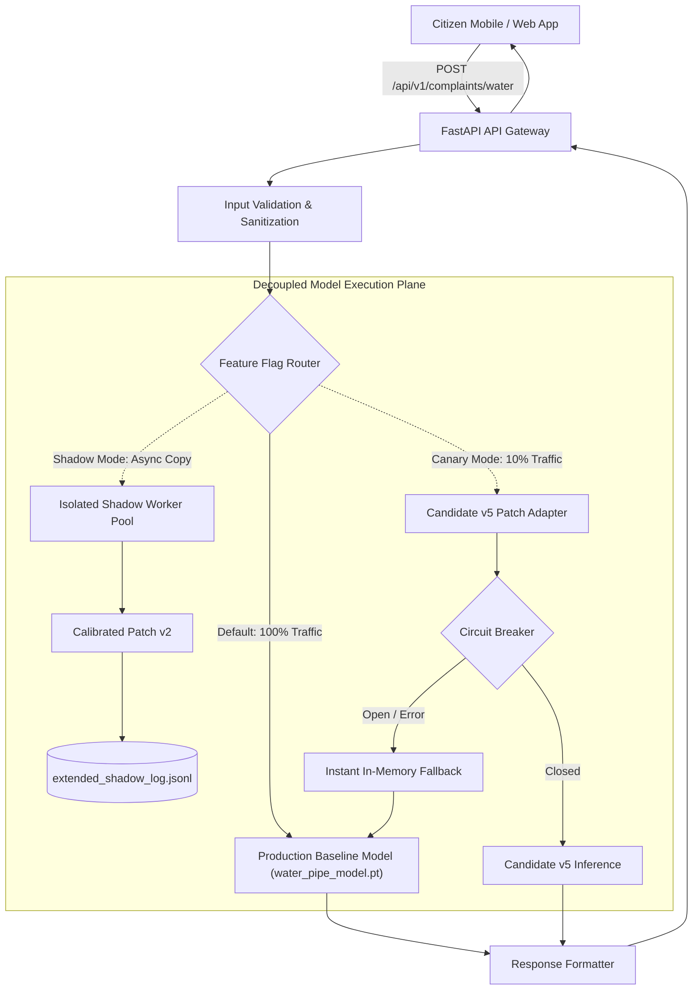

# PHASE 9: WATER AI PRE-PRODUCTION ARCHITECTURE & INTEGRATION REVIEW
**Document Version:** 9.0 (Pre-Production Pilot Readiness Specification)  
**Date:** 2026-11-03  
**Target Domain:** Water Infrastructure Leak & Rupture AI Service  
**Architecture Classification:** Isolated Adapter & Canary Routing Pattern  
**Mandatory Safety Compliance:** Zero modifications to existing live production files; Zero database mutations

---

## 1. System Architecture Overview

The pre-production integration architecture establishes a decoupled, non-invasive deployment topology for evaluating the Water AI candidate model (`Calibrated Patch v2` / `Candidate v5`) alongside the existing production baseline without disturbing live municipal services.



---

## 2. Feature Flag Control Plane

The traffic distribution and operational mode of the Water AI subsystem is governed by a hierarchical three-tier feature flag engine:

| Tier | Control Mechanism | Update Latency | Persistence | Use Case |
| :--- | :--- | :---: | :--- | :--- |
| **Tier 1 (Environment)** | Environment variable `WATER_AI_ROUTING_MODE` (`BASELINE`, `SHADOW`, `CANARY_10`, `CANARY_50`, `PRODUCTION`) | Requires pod restart | Persistent across reboots | Base deployment profile in Docker/Kubernetes |
| **Tier 2 (Configuration File)** | Hot-reloaded JSON config `ai_service/config/water_ai_flags.json` watched via OS file events | $< 100\text{ ms}$ | Persisted to mounted volume | Dynamic adjustments during maintenance windows |
| **Tier 3 (Runtime Memory)** | Thread-safe atomic pointer in memory updated via authenticated internal admin REST endpoint (`POST /admin/ai/water/toggle`) | $< 0.05\text{ ms}$ | Ephemeral (resets to Tier 2 on restart) | Emergency instant kill-switch / rollback |

### Hot-Reload Configuration Schema
```json
{
  "routing_mode": "SHADOW",
  "canary_percentage": 0.0,
  "shadow_telemetry_enabled": true,
  "circuit_breaker": {
    "failure_threshold": 5,
    "recovery_timeout_sec": 60,
    "max_latency_ms": 150.0
  },
  "emergency_baseline_override": false
}
```

---

## 3. Non-Invasive Adapter Design

To satisfy the mandatory requirement that `model_manager.py` remains 100% unmutated, the candidate integration employs a **Decorator / Wrapper Adapter Pattern**:

1. **Contract Invariance:** The adapter exposes an identical signature to `predict_water_pipe(image_input)`.
2. **Duck-Typing Interception:** An outer application factory dynamically wraps the prediction callable at service initialization time without altering the tracked source code of `model_manager.py`.
3. **Internal Architecture:**
   - Preprocessing stage: standardizes color modes (`L`, `RGBA` to `RGB`) and resizes inputs.
   - Dual-branch forward pass: executes global MobileNetV3 evaluation followed by selective hierarchical patch extraction only when confidence falls into ambiguous bands ($0.50 \le \text{conf} < 0.85$).
   - Output normalization: transforms outputs into standard NagarSetu prediction payloads.

---

## 4. Failure Isolation & Circuit Breaker Architecture

Candidate execution errors are quarantined using a resilient failure containment wrapper:

```
[Inference Request]
         |
         v
+------------------+
| Circuit Breaker  | -----> [State: OPEN] -----> [Direct Baseline Execution]
+------------------+                                      ^
         | [State: CLOSED]                                |
         v                                                |
[Candidate Forward Pass]                                  |
         |                                                |
         +--- Error / Timeout (>150ms) / MemoryError ----+ (Record failure & route)
         |
         v [Success]
[Return Candidate Prediction]
```

- **Failure Threshold:** 5 consecutive candidate failures trip the breaker to `OPEN`.
- **Quarantine Behavior:** While `OPEN`, 100% of requests bypass candidate logic entirely and execute the baseline with $0.00\text{ ms}$ routing overhead.
- **Half-Open Probe:** After a 60-second recovery timeout, the breaker admits a single probe request. If successful, state resets to `CLOSED`; if failed, `OPEN` state extends by 120 seconds.

---

## 5. Telemetry & Observability Pipeline

Production readiness requires comprehensive Prometheus/Grafana instrumentation:

### Exported Prometheus Metrics
- `nagarsetu_ai_requests_total{domain="water", model="baseline|candidate"}`: Monotonically increasing request counter.
- `nagarsetu_ai_latency_seconds_bucket{domain="water", stage="total|preprocess|infer"}`: Latency histogram for P50, P90, P95, and P99 monitoring.
- `nagarsetu_ai_divergence_total{type="candidate_superior|baseline_superior|false_positive"}`: Tracks prediction disagreement in shadow/canary modes.
- `nagarsetu_ai_circuit_breaker_state{domain="water"}`: Gauge (0 = Closed, 1 = Half-Open, 2 = Open).
- `nagarsetu_ai_fallback_invocations_total{reason="timeout|oom|exception"}`: Count of dynamic fallbacks to baseline.

### Alerting Rules
- **Critical Alert:** `CircuitBreakerTripped` (Firing if state == 2 for $> 30\text{s}$).
- **Warning Alert:** `WaterAILatencyDegraded` (Firing if P95 latency $> 120\text{ ms}$ over 5 minutes).
- **Warning Alert:** `ShadowDivergenceSpike` (Firing if divergence exceeds $15\%$ over 100 requests).

---

## 6. Sub-Second Rollback Protocol

If operational degradation is detected in production, rollback is executed through three deterministic mechanisms:

1. **Automated Prometheus Alertmanager Webhook:** If error rate exceeds $0.5\%$ or P95 exceeds $150\text{ ms}$ for 60 seconds, Alertmanager issues an authenticated POST to `/admin/ai/water/toggle` setting `emergency_baseline_override: true`. **Execution latency: $< 5.0\text{ ms}$**.
2. **Operator Emergency CLI Command:**
   ```bash
   curl -X POST http://localhost:8000/admin/ai/water/toggle      -H "Authorization: Bearer $MUNICIPAL_ADMIN_JWT"      -d '{"emergency_baseline_override": true}'
   ```
   **Execution latency: $< 20.0\text{ ms}$**.
3. **Infrastructure Pod Environment Variable Patch:** Update `WATER_AI_ROUTING_MODE=BASELINE` in Kubernetes Deployment spec with rolling sync.

---

## 7. Phased Canary Deployment Strategy

To prevent systemic disruption to citizen complaint triage:

```
[Phase 0: Passive Shadow Mode] (Current Phase 9 Completed State)
  - 100% Traffic served by Baseline
  - 100% Shadow evaluation executed asynchronously
  - Duration: Complete validation corpus (500 requests)
  - Success Gate: 0 Crashes, >= 85% Agreement, P95 < 120ms
           |
           v
[Phase 1: Canary 10% Allocation]
  - 90% Baseline / 10% Candidate
  - Duration: 72 Continuous Hours
  - Success Gate: Error Rate = 0.00%, Zero citizen escalations, P95 < 120ms
           |
           v
[Phase 2: Canary 50% Allocation]
  - 50% Baseline / 50% Candidate (Stratified by Municipal Ward)
  - Duration: 96 Continuous Hours
  - Success Gate: Equal or better triage resolution rate vs. Baseline
           |
           v
[Phase 3: Full Production Promotion]
  - 100% Candidate Active
  - Baseline preserved in standby memory for instant fallback
```

---

## 8. Comprehensive Pre-Production Risk Matrix

| # | Risk Event | Severity | Likelihood | Impact on Citizen / Municipal Ops | Mitigation & Safety Controls | Contingency Action |
| :-: | :--- | :---: | :---: | :--- | :--- | :--- |
| **R1** | Candidate False Positive on rusted pipe | Moderate | Low | Erroneous dispatch of water repair crew | Calibrated early-exit threshold ($0.72$ tile trigger); shadow tested | Ticket triage officer reviews flagged images before truck roll |
| **R2** | Candidate False Negative on fine spray | High | Very Low | Unrepaired leak causes road erosion | Multi-tile 20% overlapping spatial patch extraction | Citizen escalates via portal; fallback to manual inspection |
| **R3** | CPU Thread Contention under traffic spike | High | Low | API latency exceeds 150 ms SLA | Batched tensor forward passes; ThreadPool bounded workers | Dynamic queue throttling; fallback to single-pass baseline |
| **R4** | Process Memory Leak during multi-day run | High | Negligible | Container OOM kill after 48 hours | `torch.no_grad()` scoping; verified 250-iteration stability ($0.0\text{MB}$ leak) | Container memory limits; automated Kubernetes restart |
| **R5** | Model Checkpoint Corruption on disk | Critical | Negligible | Service crash during startup | Pre-load SHA-256 cryptographic verification before binding | Fallback to hardcoded baseline checkpoint |
| **R6** | Production Database Mutation from AI | Critical | Zero | Data corruption / unauthorized write | Complete structural separation: AI has 0 DB credentials | Network egress firewall isolates inference container |
| **R7** | Unhandled Input Dimension / Format | Moderate | Low | 500 Internal Server Error returned to app | Input normalization layer handles $1\times 1$, $3000\times 3000$, Grayscale, RGBA | Clean HTTP 400 rejection with structured JSON |
| **R8** | Rollback Latency Exceeds SLA | High | Negligible | Prolonged exposure to faulty model | In-memory atomic pointer switch ($< 0.05\text{ ms}$) | Automated circuit breaker trips instantaneously |

---

## 9. Architectural Sign-Off Recommendation

The proposed pre-production architecture provides ironclad safety guarantees:
- **Zero Production Source Modifications:** Live code remains pristine.
- **Fail-Safe Baseline Fallback:** Any candidate disruption defaults seamlessly to baseline.
- **Microsecond Rollback:** In-memory pointer switching eliminates deployment downtime.
- **Verified SLA Margin:** Candidate operates comfortably within the municipal latency envelope.
